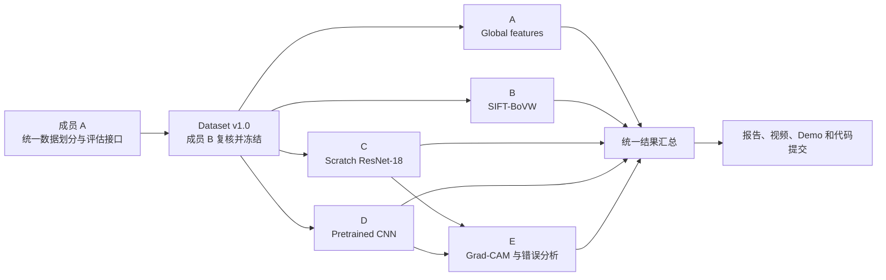

# COMP9517 Group Project 分工与依赖计划

## 1. 项目目标

- 目标分数：**26–27 分及以上**。
- 唯一重点进阶方向：**Explainability with Grad-CAM**。
- 总体策略：先完整满足 23–26 分档要求，再通过深入的 Grad-CAM 研究冲击 26–27。
- 最终截止时间：**2026 年 8 月 7 日 22:00 AET**。

## 2. 必须满足的作业要求

### 2.1 数据要求

- 从 iNaturalist-2021 `train_mini` 中随机抽取至少 500 个 species。
- 每类使用 50 张 `train_mini` 图片，建议划分为：
  - 40 张 training；
  - 10 张 validation。
- 每类使用官方 validation split 中的 10 张图片作为最终 test set。
- 预计总量：
  - 20,000 张 training；
  - 5,000 张 validation；
  - 5,000 张 test。
- 必须保存随机种子、类别列表、类别映射和三个 split 的清单。
- Training、validation 和 test 必须严格隔离，test set 不得用于调参或选择模型。

### 2.2 方法要求

- 至少完成并测试两种真正不同的完整方法：
  - 传统 handcrafted-feature + classical classifier；
  - 深度学习方法。
- 深度学习必须包含：
  - 从随机初始化训练；
  - 使用预训练权重训练。
- 为体现 23–26 分档要求的方法多样性，计划比较：
  - 不同 handcrafted descriptors；
  - 不同传统分类器；
  - Scratch 与 Pretrained；
  - 不同 CNN architecture；
  - 不同 data augmentation。
- 所有模型必须充分训练，并通过训练/验证曲线证明基本收敛。
- 消融实验应一次只改变一个设计因素。

### 2.3 评估要求

至少报告：

- Top-1 accuracy；
- Top-5 accuracy；
- Overall accuracy；
- Macro precision；
- Macro recall；
- Macro F1；
- 各方法的训练时间和测试/推理时间；
- 500 类总体混淆矩阵；
- 重点混淆物种子集分析；
- 成功案例、失败案例及原因分析。

## 3. 计划完成的实验

### 3.1 传统方法

1. Global handcrafted features：
   - Colour histogram/moments；
   - LBP；
   - HOG；
   - SVM classifier。
2. Local handcrafted method：
   - SIFT；
   - Bag-of-Visual-Words；
   - SVM；
   - Random Forest classifier comparison。

### 3.2 深度学习方法

1. ResNet-18，从随机初始化训练；
2. ResNet-18，使用 ImageNet 预训练权重；
3. EfficientNet-B0，使用 ImageNet 预训练权重。

主要对照关系：

- ResNet-18 Scratch vs ResNet-18 Pretrained：研究预训练权重的作用；
- ResNet-18 Pretrained vs EfficientNet-B0 Pretrained：比较不同 CNN architecture；
- Scratch CNN 无增强 vs 标准增强：比较 augmentation 的作用。

为了控制工作量，暂不安排大量 frozen/unfrozen fine-tuning 策略对比。如核心实验提前完成，再考虑扩展。

### 3.3 进阶方向：Grad-CAM

Grad-CAM 不能只生成热力图，需要围绕以下问题进行分析：

1. 正确分类时，模型是否关注生物主体，而不是背景？
2. 错误分类时，模型关注了哪些错误区域？
3. 对错误案例，预测类别和真实类别对应的 Grad-CAM 有何区别？
4. 最容易混淆的物种对关注了哪些相同或不同的局部特征？
5. Scratch 和 Pretrained ResNet-18 对同一图片的关注区域是否不同？

建议准备：

- 10 个正确且高置信度案例；
- 10 个错误案例；
- 3–5 组高频混淆物种对；
- 部分案例同时比较 Scratch 与 Pretrained；
- 报告最终展示约 8–12 个最有代表性的 Grad-CAM panels，其余用于视频和软件演示。

案例应依据混淆次数、预测置信度等规则选择，避免只挑选视觉效果好的图片。

## 4. 五人分工

成员字母对应姓名：

| 成员 | 姓名 | 主要技术与代码工作 | 主要实验 | 报告内容 | 视频内容 |
|---|---|---|---|---|---|
| A | Xiangze Xue | 统一数据划分、类别映射、公共评估；Colour/LBP/HOG + SVM | Descriptor 消融、数据审计、基础指标 | Dataset、Experimental Setup、基础传统方法 | 问题、数据集和评估方式 |
| B | Zhigeng Qiao | SIFT-BoVW + SVM/Random Forest | Classifier 对比、BoVW 配置及传统方法时间 | 传统方法、相关文献和结果 | Handcrafted pipeline 和消融结论 |
| C | Zhiyang Ding | ResNet-18 Scratch | Augmentation 消融、收敛曲线、训练时间 | Scratch CNN、训练动态和结果 | 从零训练、曲线和主要问题 |
| D | Yongqi Yang | ResNet-18 Pretrained + EfficientNet-B0 Pretrained | Pretraining 对比、architecture 对比 | Transfer Learning 和深度模型结果 | 预训练、架构比较和主要结果 |
| E | Xinyan Chen | Grad-CAM、错误案例筛选、混淆分析 | 正确/错误/混淆物种、Scratch/Pretrained 注意力对比 | Grad-CAM、Error Analysis、Discussion | 可解释性发现和软件演示 |

### 4.1 额外整合职责

- A：数据版本和公共评估接口；
- B：代码结构、README 和最终 ZIP 检查；
- C：随机种子、checkpoint 和实验记录规范；
- D：CVPR LaTeX 报告整合；
- E：Grad-CAM demo、幻灯片和视频整合；
- 所有人：编写自己负责的报告内容、提供相关引用、参加视频录制并讲解自己的模块。

整合负责人只负责统一格式，不代表其他成员不需要参与对应工作。

## 5. 依赖关系



关键依赖：

1. A 必须先完成数据选择和 split；
2. B 复核后冻结 `Dataset v1.0`；
3. A、B、C、D 使用完全相同的数据并行实验；
4. C、D 提供最终 checkpoint 和预测结果后，E 才能完成正式 Grad-CAM；
5. 所有结果冻结后，才能完成最终报告、视频和 demo。

## 6. 数据准备与冻结流程

### 6.1 成员 A 的数据工作

A 负责确定“使用哪些图片”，不负责替所有方法完成 resize、normalization 或特征提取。

主要步骤：

1. 固定随机种子并随机抽取 500 个类别；
2. 生成 40/10/10 的 train/val/test 清单；
3. 建立统一 `class_index`；
4. 保留 annotation 中的 family、genus、species 等 taxonomy；
5. 检查图片可读取性、数量、路径、标签和 split 重叠；
6. 生成数据统计和复现说明。

建议共享：

```text
data_metadata/
├── selected_classes.json
├── class_to_idx.json
├── train.csv
├── val.csv
├── test.csv
├── taxonomy.csv
├── dataset_summary.json
└── README.md
```

CSV 建议至少包含：

```text
image_path
original_category_id
class_index
family
genus
species
split
```

### 6.2 成员 B 的复核

B 不重新抽取数据，只做独立复核：

- 是否有 500 类；
- 是否每类为 40/10/10；
- 三个 split 是否没有交叉；
- 类别编号是否统一；
- test 是否来自官方 validation split；
- taxonomy 是否正确对应；
- 随机种子和类别列表是否已保存。

通过后标记为：

```text
Dataset v1.0 - FROZEN
```

冻结后，所有正式实验必须使用这一版本。除非发现严重错误，否则不得私自更改类别或 split。

### 6.3 各方法的专属预处理

数据冻结后，各成员仍可根据方法进行不同预处理：

- A/B：灰度、Colour、LBP、HOG、SIFT、BoVW；
- C/D：resize、crop、augmentation、normalization；
- E：必须使用与被分析 CNN 完全相同的输入处理。

各方法预处理可以不同，但输入图片必须来自同一份 `train.csv`、`val.csv` 和 `test.csv`。

## 7. 并行工作安排

数据冻结后，A、B、C、D 可以立即并行。E 不需要空等：

### 模型完成前，E 可以先做

- 阅读并整理 Grad-CAM 论文；
- 准备 Grad-CAM 实现；
- 使用临时预训练模型验证流程；
- 设计案例筛选规则；
- 准备混淆分析和报告图表模板；
- 规划软件 demo。

### C/D 完成后，E 再做

- 加载正式 checkpoint；
- 根据测试预测筛选案例；
- 分析正确、错误和高频混淆物种；
- 对比 Scratch 与 Pretrained 的注意区域；
- 提炼可以写入报告的具体结论。

## 8. 统一实验输出格式

每个方法负责人必须输出一致的实验记录：

```text
experiment_config.json
metrics.json
predictions.csv
timing.json
training_history.csv   # 深度学习方法需要
```

`experiment_config.json` 应记录：

- 模型/方法名称；
- 随机种子；
- 数据版本；
- 主要超参数；
- optimizer 和 learning rate；
- epochs；
- augmentation；
- 使用的预训练权重。

`predictions.csv` 至少包含：

```text
image_path
true_class
predicted_class
top5_classes
confidence
```

统一格式用于生成：

- 全方法对比表；
- Top-1、Top-5 和 macro metrics；
- 训练/推理时间比较；
- 500 类混淆矩阵；
- 高频混淆物种子矩阵；
- Grad-CAM 案例清单。

## 9. 每位成员的最低个人交付

为满足个人贡献要求，每个人都必须有：

1. 自己实现或主要负责的一部分代码；
2. 自己负责的一组实验和结果；
3. 自己撰写的报告内容；
4. 自己整理的方法引用和超参数；
5. 自己的视频讲解；
6. 对自己模块成功与失败案例的解释。

不能出现有人只写报告、只剪视频或只查资料而不参与方法和代码的情况。

## 10. 报告、视频与代码提交

### 10.1 报告

- 使用官方 CVPR LaTeX 模板；
- 使用 `\usepackage[pagenumbers]{cvpr}`；
- 正文最多 10 页，references 不计入；
- PDF 不超过 10MB；
- 必须包含 Introduction、Literature Review、Methods、Experimental Results、Discussion、Conclusion 和 References。

### 10.2 视频

- 最多 10 分钟，超过部分不计分；
- 720p 或 1080p MP4；
- 不超过 100MB；
- 必须包含软件/方法演示；
- 所有成员都必须讲解；
- 每位成员讲解时需要动态摄像头画面，并先说明姓名。

建议 demo：

```text
选择测试图片
→ 输出 Top-5 预测和真实类别
→ 显示 Grad-CAM
→ 解释模型关注区域与预测结果
```

### 10.3 代码

- 最终提交 ZIP 不超过 40MB；
- 不包含训练数据、模型权重和结果图片；
- 代码结构清楚、注释充分；
- README 说明环境、运行方法和外部库/代码来源；
- 只由一名成员代表全组提交全部交付物。

## 11. 建议里程碑

| 时间 | 目标 |
|---|---|
| 7 月 14–16 日 | 确认分工、数据规则、随机种子和实验范围 |
| 7 月 17–20 日 | A 完成 Dataset v1.0，B 完成复核；全组完成小规模 pilot |
| 7 月 21–27 日 | A/B 传统方法、C/D 深度模型并行训练与消融 |
| 7 月 28–31 日 | 冻结主要模型和预测；E 完成正式 Grad-CAM 与错误分析 |
| 8 月 1–3 日 | 汇总结果、完成报告初稿和图表 |
| 8 月 4–5 日 | 完成 slides、demo 和五人视频录制 |
| 8 月 6 日 | 检查报告格式、压缩视频、整理代码 ZIP、模拟提交 |
| 8 月 7 日 | 建议 18:00 前由指定成员提交，硬截止 22:00 AET |

## 12. 当前需要全组确认的事项

- [x] A–E 分别对应哪位成员（A Xiangze Xue / B Zhigeng Qiao / C Zhiyang Ding / D Yongqi Yang / E Xinyan Chen）；
- [ ] 数据存储位置和共享方式；
- [ ] 固定随机种子；
- [ ] ResNet-18 和 EfficientNet-B0 是否采用统一输入尺寸；
- [ ] 每位成员可用的 GPU/Colab 资源；
- [ ] 实验结果和 checkpoint 的共享位置；
- [ ] 报告 LaTeX 仓库负责人；
- [ ] 最终提交负责人；
- [ ] 每周固定同步时间。
