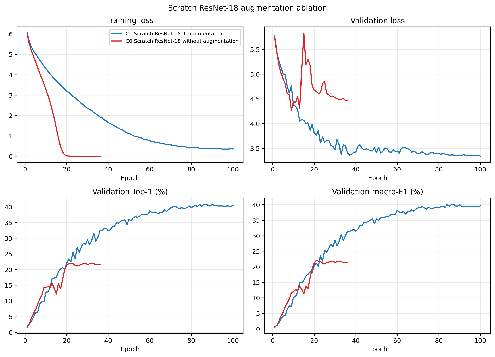

# Scratch ResNet-18 and Controlled Augmentation Ablation

This is a merge-ready contribution for the group report. The content can be
placed under the shared Literature Review, Methods, Experimental Results and
Discussion sections. It should be identified by the method name rather than by
the internal member label. The common dataset description is intentionally not
repeated here.

## Literature Review

Residual networks use identity shortcut connections to learn residual
functions, which makes deeper convolutional models easier to optimise
[@He_2016_CVPR]. We selected ResNet-18 because it provides enough capacity for
500-way classification while remaining practical to train repeatedly from
scratch on one GPU.

Data augmentation is commonly used when the amount of labelled data is
limited. Transformations such as cropping and horizontal flipping show the
network different views of the same training image and can reduce overfitting
when they preserve the class label [@Shorten_2019_Augmentation]. Instead of
assuming that augmentation helps, this experiment measures its effect through
a controlled ablation. A cosine learning-rate schedule is used during training,
following the cosine annealing approach introduced by Loshchilov and Hutter
[@Loshchilov_2017_SGDR].

## Method

### Scratch ResNet-18

We used the torchvision ResNet-18 implementation and set `weights=None`, so no
ImageNet or other pretrained parameters were loaded. The original classifier
was replaced with a linear layer containing 500 outputs. Images were converted
to RGB and normalised using the ImageNet channel mean and standard deviation.
This normalisation only fixes the input scale and does not transfer learned
weights.

The model was trained with cross-entropy loss and stochastic gradient descent.
The initial learning rate was 0.05, momentum was 0.9, and weight decay was
`1e-4`. We used cosine annealing over a maximum of 100 epochs, batch size 128,
and automatic mixed precision on the GPU. The random seed was fixed to 9517 and
reset before each model was constructed, giving C0 and C1 the same initial
weights.

The checkpoint with the highest validation macro-F1 was selected. Early
stopping used patience 15 and minimum improvement `1e-4`. The held-out test set
was used only after the model and preprocessing were frozen.

### Controlled augmentation ablation

The two runs differ only in their training transform:

- **C0 (no random augmentation):** `Resize(256)`, `CenterCrop(224)`, tensor
  conversion and normalisation.
- **C1 (standard augmentation):** `RandomResizedCrop(224)`,
  `RandomHorizontalFlip`, tensor conversion and normalisation.

Validation and test images use the same deterministic resize and centre crop
in both runs. Colour jitter was not used. Dataset manifests, class mapping,
architecture, initial weights, optimiser, scheduler, batch size, epoch budget,
checkpoint rule and evaluation code were otherwise identical. Therefore, the
performance difference is attributed to random crop and horizontal flip under
the tested seed.

## Experimental Results

The experiments used the group's frozen 500-class manifests with 20,000
training, 5,000 validation and 5,000 held-out test images. They were run with
PyTorch 2.12.1 on an NVIDIA RTX 4080 Laptop GPU. Training time below is the sum
of training epochs and excludes validation. Test inference time measures the
model evaluation pass over all 5,000 images.

| Run | Test Top-1 | Test Top-5 | Macro-P | Macro-R | Macro-F1 | Loss | Best epoch | Stop epoch | Train time | Test inference |
|---|---:|---:|---:|---:|---:|---:|---:|---:|---:|---:|
| C0: no random augmentation | 21.62% | 44.24% | 23.82% | 21.62% | 21.42% | 4.5340 | 21 | 36 | 13.40 min | 5.18 s |
| C1: standard augmentation | 41.32% | 64.16% | 41.40% | 41.32% | 40.45% | 3.3001 | 87 | 100 | 34.86 min | 6.77 s |

C1 improves test Top-1 by 19.70 percentage points, Top-5 by 19.92 points and
macro-F1 by 19.03 points. Validation and test performance are close: C0 obtains
21.90% validation Top-1 and 22.11% validation macro-F1, while C1 obtains 40.90%
and 40.17%. This does not show an unusual gap between the model-selection split
and held-out test split.

The shared group evaluator reports C1 Top-5 as 64.18%, while the original
frozen metrics JSON reports 64.16%. One test image has an exact logit tie at the
fifth-ranked boundary, and NumPy stable sorting and `torch.topk` select different
classes for that position. Top-1 and all macro metrics are identical. The group
comparison may use 64.18% if it consistently reports the shared evaluator; the
C0/C1 ablation table may retain the original frozen 64.16% with this note.

**Suggested figure caption.** Training and validation dynamics for the
controlled augmentation ablation. C0 quickly memorises the unaugmented training
views and stops after epoch 36. C1 trains for 100 epochs and achieves much
higher validation Top-1 and macro-F1.

### Training dynamics

C0 reaches 99.99% training Top-1 at its best epoch and almost zero training
loss, but its best validation macro-F1 is only 22.11%. It stops at epoch 36
after 15 epochs without improvement. C1 fits the training set more slowly and
reaches its best checkpoint at epoch 87, where training Top-1 is 91.47% and
validation macro-F1 is 40.17%. The lower training accuracy together with much
higher validation performance is consistent with augmentation acting as a
strong regulariser.

## Discussion

The ablation shows that basic augmentation is important when ResNet-18 is
trained from scratch with only 40 training images per class. Without random
views, C0 learns the fixed training images almost perfectly but generalises
poorly. Random resized cropping changes the scale and position of the organism,
while horizontal flipping removes one fixed orientation. The model must learn
features that remain useful under these changes. Because the two runs are
controlled apart from the training transform, the large test gap provides
direct evidence that these transformations improve generalisation in this
experiment.

Augmentation does not solve the complete fine-grained classification problem.
C1 correctly classifies 2,066 of 5,000 test images and makes 2,934 errors. Nine
classes are recognised correctly for all ten test images, while 28 classes are
never recognised. Frequent unordered confusion pairs include *Aquila heliaca*
and *Pernis apivorus*, *Myosotis latifolia* and *Myosotis scorpioides*, and
same-genus *Echinocereus* and *Ajuga* pairs. These errors are consistent with
small visual differences between related species, but confusion counts alone
cannot prove whether the network uses the organism or the background. The
group's Grad-CAM analysis should make that claim only after inspecting matched
correct, incorrect and confusable examples.

Two limitations apply. First, only seed 9517 was used because full scratch
training is expensive, so the improvement is a controlled single-seed result
rather than a multi-seed significance claim. Second, the ablation covers only
random resized cropping and horizontal flipping. Other augmentation policies
may improve performance further, but adding them without separate ablations
would weaken the interpretation. C1 should be used as the scratch baseline for
the group's pretrained-model and Grad-CAM comparisons.

## References used by this contribution

The corresponding verified BibTeX entries are provided in
`member_c_references.bib`:

- He et al., *Deep Residual Learning for Image Recognition*, CVPR 2016.
- Shorten and Khoshgoftaar, *A Survey on Image Data Augmentation for Deep
  Learning*, Journal of Big Data, 2019.
- Loshchilov and Hutter, *SGDR: Stochastic Gradient Descent with Warm Restarts*,
  ICLR 2017.

